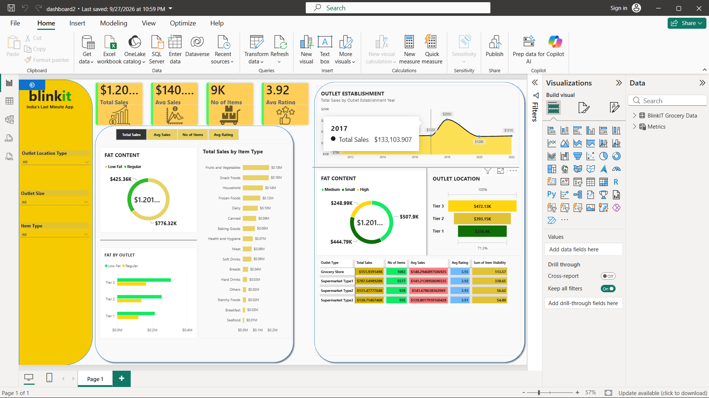

# BlinkIT Grocery Data Analysis

## Project Overview
This project focuses on analyzing grocery sales data from BlinkIT using Microsoft Power BI.

## Tools Used
- Microsoft Power BI
- Power Query
- DAX

## Project Objectives
- Analyze overall grocery sales.
- Understand sales performance by outlet.
- Compare product categories.
- Identify customer preferences and sales trends.

## Key Metrics
- Total Sales
- Average Sales
- Number of Items
- Average Rating

## Dashboard
The interactive Power BI dashboard is available in the `.pbix` file uploaded in this repository.

## Skills Demonstrated
- Data Cleaning
- Data Transformation
- Data Visualization
- Dashboard Development
- Business Data Analysis

## Dashboard Preview

